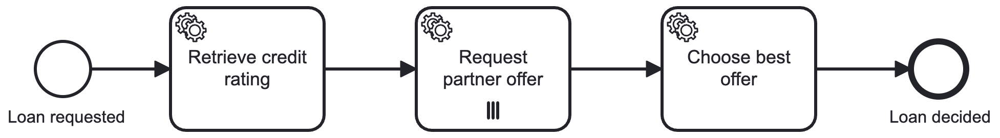
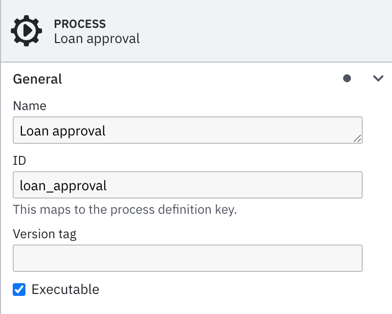
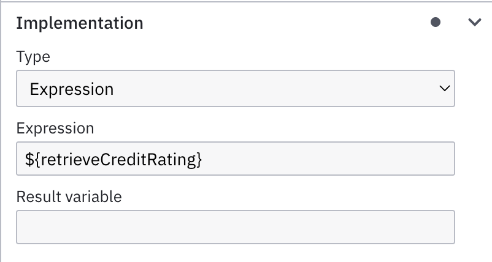
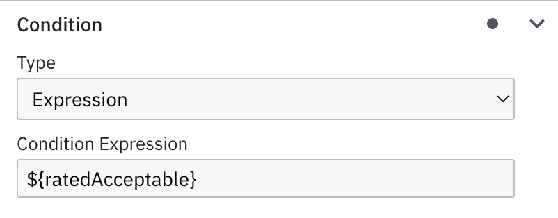
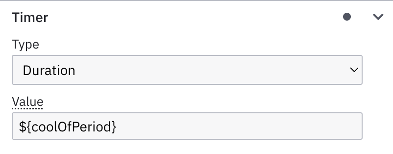
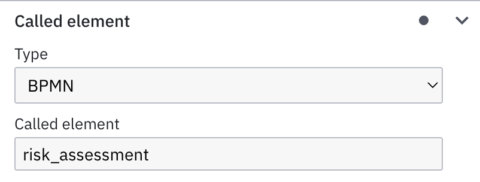
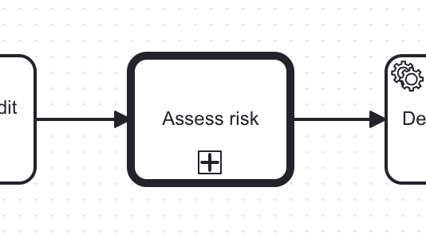
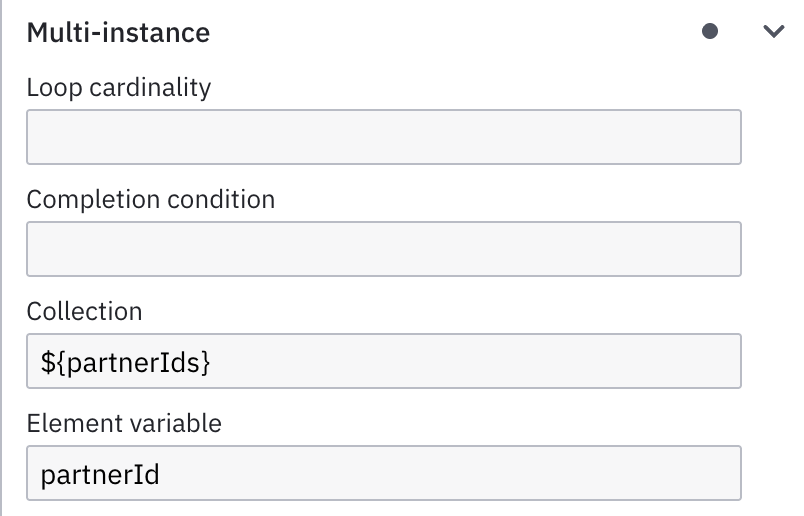
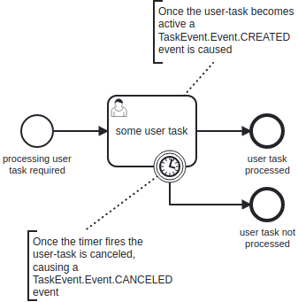

[](./LICENSE)

*Vanilla BP* is **an aspect orientated service provider interface (SPI) for workflow systems as a Java developer would expect it to be**.

Every example on this page is about approving a loan. A customer asks for an amount, a credit rating is retrieved, partners are asked for an offer, and the request is decided. The [VanillaBP blueprints](https://github.com/vanillabp-blueprints) implement the same business case, so a link from here leads to a model you have already read about. The blueprints name their beans after their role (`Workflow`, `WorkflowTaskHandler`, `Service`), because each blueprint holds exactly one workflow. This page names the classes after the business case (`LoanApproval`, `LoanApprovalService`), because the examples stand next to each other without that context. The process id, the message names, the task names and the attributes of the workflow-aggregate are exactly the same in both places.

*Heads up:* If you want to know what we had in mind when we created this SPI, also read the [About the SPI](#about-the-spi) section afterwards :wink:. It also links to the [available adapters](#available-adapters), which connect this SPI to an existing workflow system.

*This README documents the SPI itself.* The [VanillaBP wiki](https://github.com/vanillabp/adapter-platform-integration/wiki) says how you set it up in an application: workflow modules, aggregate persistence, configuration, and the platform you run on (Spring Boot, Quarkus). It also links to the wiki of each BPMS adapter.

## Content

1. [How it looks like](#how-it-looks-like)
2. [Usage](#usage)
   1. [Process-specific workflow-aggregate](#process-specific-workflow-aggregate)
   2. [Start a workflow](#start-a-workflow)
   3. [Wire up a process](#wire-up-a-process)
   4. [Wire up a task](#wire-up-a-task)
   5. [Wire up an expression](#wire-up-an-expression)
3. [Advanced topics](#advanced-topics)
   1. [Process variables](#process-variables)
   2. [What the BPMS gets to see](#what-the-bpms-gets-to-see)
   3. [Natural ids](#natural-ids)
   4. [Correlate an incoming message](#correlate-an-incoming-message)
   5. [Broadcast a signal](#broadcast-a-signal)
   6. [Tell the BPMS that the aggregate changed](#tell-the-bpms-that-the-aggregate-changed)
   7. [Learn that a workflow ended](#learn-that-a-workflow-ended)
   8. [Versioning of BPMN business-processes](#versioning-of-bpmn-business-processes)
   9. [Call-activities](#call-activities)
   10. [Multi-instance](#multi-instance)
   11. [User tasks and asynchronous tasks](#user-tasks-and-asynchronous-tasks)
   12. [The workflow module a service belongs to](#the-workflow-module-a-service-belongs-to)
   13. [What the API throws](#what-the-api-throws)
4. [Viewing BPMN and execution history of workflows](#viewing-bpmn-and-execution-history-of-workflows)
   1. [Showing the BPMN of a simple workflow](#showing-the-bpmn-of-a-simple-workflow)
   2. [Showing the BPMN of a complex workflow](#showing-the-bpmn-of-a-complex-workflow)
5. [About the SPI](#about-the-spi)
   1. [Prerequisites](#prerequisites)
   2. [Motivation](#motivation)
   3. [Goals](#goals)
   4. [Available Adapters](#available-adapters)
   5. [Concept](#concept)
6. [Decision log](#decision-log)
7. [Contributing](#contributing)
8. [Noteworthy & Contributors](#noteworthy--contributors)
9. [License](#license)

## How it looks like

Here is a part of a loan approval workflow. It gives you an idea of how your business code uses the Vanilla BP SPI:



```java
@Component
@WorkflowService(
        workflowAggregateClass = LoanApproval.class,
        bpmnProcess = @BpmnProcess(bpmnProcessId = "loan_approval"))
public class LoanApprovalService {

    @Autowired
    private ProcessService<LoanApproval> processService;

    @Autowired
    private CreditRatingClient creditRatings;

    @Autowired
    private PartnerClient partners;

    @Transactional
    public String loanRequested(
            final String loanRequestId,
            final int amount) {

        final var loanApproval = new LoanApproval(loanRequestId, amount);
        ...
        return processService
                .startWorkflow(loanApproval)
                .getLoanRequestId();
    }

    @WorkflowTask
    public void retrieveCreditRating(
            final LoanApproval loanApproval) {

        if (loanApproval.getCreditRating() != null) {
            return; // a BPMS may deliver a task twice
        }

        loanApproval.setCreditRating(
                creditRatings.rate(
                        loanApproval.getLoanRequestId(),
                        loanApproval.getAmount()));
    }

    @WorkflowTask
    public void requestPartnerOffer(
            final LoanApproval loanApproval,
            @MultiInstanceElement("ServiceTask_RequestPartnerOffer")
            final String partnerId) {

        partners.requestOffer(
                partnerId,
                loanApproval.getLoanRequestId(),
                loanApproval.getAmount());
    }
    ...
```

The `@Transactional` is on the method which calls `ProcessService`, and on no other method of the class. Starting a workflow needs a transaction of yours. A task method must not have one. VanillaBP runs a task method in a transaction of its own. It commits that transaction when a [`TaskException`](#wire-up-a-task) passes it. If an application transaction joined in, it would turn this into a rollback. So the application does not start if a transaction annotation covers a `@WorkflowTask` method, and the message names the method.

The first thing `retrieveCreditRating` does is check whether there is a rating already. A remote BPMS may deliver the same task more than once. So write a task method in a way that it can run again, and let the state of the aggregate decide what is left to do.

## Usage

### Process-specific workflow-aggregate

Usually a workflow needs data to do its job. This might be a customer ID or an order ID. For the loan approval it is the requested amount and the credit rating retrieved for it:

```java
@Entity
@Table(name = "LOAN_APPROVAL")
@Getter
@Setter
public class LoanApproval {
  @Id
  private String loanRequestId; // see section "Natural ids"
  private Integer amount;
  private Integer creditRating;
  private String ratingBand;
  private String outcome;
}
```

This data belongs to exactly one workflow (a running instance of a BPMN process), and the workflow has exactly this data.
The Vanilla BP SPI stores these values in an entity of its own for each workflow. In domain-driven design (DDD) this whole tree is called *an aggregate*.

If you use JPA to persist the aggregate, this entity may be split up into several sub-entities
(many-to-many, one-to-many, many-to-one relations and embedded objects). But the root of that entity tree is the record connected to the workflow.

You can also use another persistence technology than JPA, for example a NoSQL database.
The documentation of the platform integration has the details.

### Start a workflow

There is a ready-to-use service bean called `ProcessService`. It is a generic bean. Its generic parameter is the class of the workflow aggregate. You can inject it in any Spring component:

```java
@Autowired
private ProcessService<LoanApproval> processService;
```

To start a workflow, call it in a bean method. Such a method is usually called because of a business event (e.g. a user clicks a button):

```java
@Transactional
public void loanRequested(LoanRequest request) {
     // use the request to initialize the aggregate
     var loanApproval = new LoanApproval(request);
     // start the process
     processService.startWorkflow(loanApproval);
}
```

The aggregate is persisted and the workflow is started in the transaction of the caller. So a workflow without its aggregate cannot happen. The method returns the persisted aggregate. Where the persistence layer works that way (e.g. JPA), it is attached.

If the process starts with a message start event instead of a plain start event, use `startWorkflowByMessage(aggregate, messageName)`:

```java
processService.startWorkflowByMessage(loanApproval, "LoanRequested");
```

Only the *name* of the message reaches the BPMS. Put whatever the message carried on the aggregate before the call. This is the same rule as for [correlating a message](#correlate-an-incoming-message).

#### Workflows nobody started through VanillaBP

Some workflows start without anybody asking VanillaBP. A timer start event fires. A signal start event receives a broadcast. The condition of a conditional start event becomes true. Or somebody with access to the BPMS starts the process directly. Then nobody gives VanillaBP an aggregate, so your workflow service has to build one:

```java
@WorkflowStartedByBpms
public NightlyReview buildAggregate(BpmsStartTrigger trigger, @TaskParam("dueAt") Instant dueAt) {
     return new NightlyReview(UUID.randomUUID().toString(), dueAt);
}
```

The aggregate you return names the workflow. The id of a workflow is the id of its workflow aggregate, and you assign it. You do it here, or you let the persistence layer assign one on save. VanillaBP then tells the BPMS about it. Camunda 7 keeps it as the business key. Camunda 8 and the Process-Engine-API keep it as a process variable named after the id attribute of your aggregate.

If one process has several start events and the aggregate differs per event, name the event:

```java
@WorkflowStartedByBpms(id = "StartEvent_ScheduledReview")
public NightlyReview buildScheduledReview(@TaskParam("region") String region) {
     return new NightlyReview(UUID.randomUUID().toString(), region);
}
```

The method may take a `BpmsStartTrigger` and process variables via `@TaskParam`, in any order. A `@WorkflowTask` method gets its parameters the same way. The trigger says which kind of start event fired (`NONE`, `MESSAGE`, `TIMER`, `SIGNAL` or `CONDITIONAL`), the name of the signal if it was one, and the BPMN id of the start event.

The trigger carries no time. The time a start event fired is your own value. Put it into the model as an expression, read it as a `@TaskParam` and store it on your aggregate. No BPMS tells a start listener the time it planned the start for, so an adapter would have to make that value up.

A process which is never started past VanillaBP needs no such method. If one is started that way anyway, VanillaBP refuses the start with a message which shows the method to write. The BPMS turns the refusal into an incident. A workflow you started through `startWorkflow` never reaches the method, because it already has its id and its aggregate.

The [wiki of the adapter platform](https://github.com/vanillabp/adapter-platform-integration/wiki/Starting-workflows) says whether your BPMS can serve such a start at all. The blueprint [`bpmn-bpms-initiated-start`](https://github.com/vanillabp-blueprints/bpmn-bpms-initiated-start-springboot) shows it running.

### Wire up a process

Your business code starts a workflow or correlates a message (see the [Advanced topics](#correlate-an-incoming-message) section), usually because of a business event (e.g. a user clicks a button). Wiring a process, a task or an expression is different. It connects BPMN elements to your software components, and here the workflow system starts the action. So the engine needs markers which tell it where to find the code to run.

The binding uses names, in an aspect-oriented style. It is based on the BPMN process-id:



*Screenshot of [Camunda Modeler](https://camunda.com/en/download/modeler/)*

#### Software-first approach

Developers may use BPMN and a BPMN engine to make their software easier to read and to maintain, because it takes a lot of coding away. In this case the service bean may be written first.

Use the class name of the service as the process-id in the BPMN. Then the `@WorkflowService` annotation is all it takes to wire the component to the process:

```java
@Component
@WorkflowService(workflowAggregateClass = LoanApproval.class)
public class LoanApprovalService {
  ...
}
```

The BPMN then carries `LoanApprovalService` as its process-id, and nothing else is needed. The annotation attribute `workflowAggregateClass` is mandatory. It names the class used as the workflow-aggregate of this workflow.

#### BPMN-first approach

If the BPMN file is given and its process-id is not the class name, map the component with the `bpmnProcess` attribute:

```java
@Component
@WorkflowService(
        workflowAggregateClass = LoanApproval.class,
        bpmnProcess = @BpmnProcess(bpmnProcessId = "loan_approval")
    )
public class LoanApprovalService {
  ...
}
```

If the service bean gets too big because the workflow has many tasks, you can annotate several service beans with the same `@WorkflowService` annotation. Just do not wire a task twice. If a method is wired twice anyway, this is found at startup and reported with an exception.

Put the annotation on the class which holds the `@WorkflowTask` methods. An interface with the annotation is refused. So is an annotation of your own which contains it. The message names the type and the classes which brought it in. The reason: Java does not inherit a method annotation from an interface. So the handlers you wrote would not be the ones VanillaBP finds, and Spring Boot and Quarkus would not even find the same ones. If several classes should share one declaration, put it on a common superclass. A superclass is inherited, and that works.

### Wire up a task

Like [wiring a process](#wire-up-a-process), the task binding uses an aspect-oriented approach. It works for service tasks, send tasks, business rule tasks and user tasks.



*Screenshot of [Camunda Modeler](https://camunda.com/en/download/modeler/)*

The `@WorkflowTask` annotation marks the method which is responsible for a BPMN task:

```java
@WorkflowTask
public void retrieveCreditRating(LoanApproval loanApproval) {
  ...
}
```

#### Software-first approach

Here the BPMN task definition has to carry the name of the method (e.g. `retrieveCreditRating`), as in the screenshot above:

```java
@WorkflowTask
public void retrieveCreditRating(LoanApproval loanApproval) {
  ...
}
```

#### BPMN-first approach

If the BPMN is given and its name does not match the name of the method, map it with the annotation attribute `taskDefinition`:

```java
@WorkflowTask(taskDefinition = "RETRIEVE_CREDIT_RATING")
public void retrieveCreditRating(LoanApproval loanApproval) {
  ...
}
```

Or wire the task by its BPMN id:

```java
@WorkflowTask(id = "ServiceTask_RetrieveCreditRating")
public void retrieveCreditRating(LoanApproval loanApproval) {
  ...
}
```

One method may serve several BPMN elements, because the annotation is repeatable. The compiler collects the annotations in the container `@WorkflowTasks`.

```java
@WorkflowTask(taskDefinition = "retrieveCreditRating")
@WorkflowTask(taskDefinition = "refreshCreditRating")
public void retrieveCreditRating(LoanApproval loanApproval) {
  ...
}
```

#### Workflow-aggregate argument

```java
@WorkflowTask
public void retrieveCreditRating(LoanApproval loanApproval) {
  ...
}
```

As the section [Process-specific workflow-aggregate](#process-specific-workflow-aggregate) says, each workflow has an entity record as its workflow-aggregate. So whenever a service method is called, it accepts one parameter: the workflow-aggregate with the values of the current workflow.

*Hint:* These workflow task methods return no value. They work on the data of the workflow-aggregate, and they store new data there if needed. So just change the field values of the aggregate. The [BPMS-specific adapter](#available-adapters) takes care of persisting them.

#### Values the model maps into the task

A BPMN task may carry an input mapping. With it a model hands a task a value which the aggregate does not hold. A parameter annotated with `@TaskParam` picks up such a value:

```java
@WorkflowTask
public void retrieveCreditRating(
        LoanApproval loanApproval,
        @TaskParam("ratingProvider") String provider) {
  ...
}
```

This is the only way a value comes *into* your code without passing the aggregate. It is a value of the model. So the model may point the task at another rating provider, and the code does not change.

The parameter may be a `String`, any of the number types, a `Boolean` or `Object`. VanillaBP converts what the BPMS reported into the type you declared. A number is converted only if the conversion keeps the number as it is. So a `BigDecimal` of `120.50` reaches a `Double` parameter as `120.5`. The same value bound to an `int` does not arrive as `120`. Instead the task ends with a message which names the value and the type. Declare the parameter as `Object` if you want to see the value the way your BPMS sent it. The [documentation of the migration adapter](https://github.com/vanillabp/adapter-platform-integration/blob/main/migration-adapter/README.md) lists the pairs.

#### The transaction is VanillaBP's

VanillaBP loads the aggregate, calls the method and saves the aggregate, all in one transaction of its own. Do not declare a transaction of your own on a workflow service class or on a `@WorkflowTask` method. It would join the transaction of VanillaBP. As soon as a `TaskException` passes, it would mark the transaction rollback-only. Then everything the method wrote is thrown away, although the workflow takes the BPMN error path. VanillaBP does not let that happen unnoticed: it refuses to start and names the method. Methods which call `ProcessService` do need their own transaction, so annotate those instead of the whole class.

#### What a task method may throw

A task method can end badly in two ways, and the BPMN reacts differently to each of them.

```java
@WorkflowTask
public void retrieveCreditRating(LoanApproval loanApproval) {

    // the rating provider is down: a technical failure
    final var rating = creditRatings.rate(loanApproval.getLoanRequestId());

    loanApproval.setCreditRating(rating);

    if (rating < MINIMUM_RATING) {
        loanApproval.setRejectionReason("rating " + rating + " is too low");
        // a business outcome the model has an error boundary event for
        throw new TaskException("loan-rejected");
    }
}
```

A `TaskException` is not a failure. It names a BPMN error code, and the workflow leaves the task through the matching error boundary event. Everything the method wrote onto the aggregate **is committed** on the way out, including the rejection reason above. If a model has a separate error name and error code, use the second constructor, which takes both (`new TaskException("Loan rejected", "loan-rejected")`). You read them with `getErrorName()` and `getErrorCode()`. Every other exception is a technical failure. Nothing is committed, and the BPMS retries the way it always does. The model and the method decide together which of the two happened. That is why the transaction has to stay with VanillaBP.

The blueprint [`bpmn-service-task`](https://github.com/vanillabp-blueprints/bpmn-service-task-springboot) runs all three outcomes. [`bpmn-error-escalation`](https://github.com/vanillabp-blueprints/bpmn-error-escalation-springboot) shows what a model does with the error afterwards.

### Wire up an expression

Expressions are used in two main cases:

1. A path has to be chosen (exclusive gateway, inclusive gateway, conditional flows)

   

   *Screenshot of [Camunda Modeler](https://camunda.com/en/download/modeler/)*

2. A value has to be calculated (e.g. x business days as a timer event definition)

   

   *Screenshot of [Camunda Modeler](https://camunda.com/en/download/modeler/)*

The expression in the BPMN reads the value from the workflow-aggregate. It uses a getter, or the named field if there is no getter. A getter can also compute the result on the fly:

```java
@Entity
@Table(name = "LOAN_APPROVAL")
public class LoanApproval {
    ...
    private String ratingBand;
    ...
    public boolean isRatedAcceptable() {
       return "acceptable".equals(ratingBand);
    }
    ...
    public String getCoolOffPeriod() {
        var holidays = HolidayManager.getInstance(HolidayCalendar.AUSTRIA);
        var nextBusinessDay = Instant.now();
        while (holidays.isHoliday(nextBusinessDay)) {
            nextBusinessDay = nextBusinessDay.plus(1, ChronoUnit.DAYS);
        }
        return Duration.between(Instant.now(), nextBusinessDay).toString();
    }
}
```

A getter is worth it: the model asks a question (`ratedAcceptable`) instead of comparing numbers itself. The data behind the answer can still change. So `ratingBand` can become an enum or three columns later, and neither the BPMN nor a running workflow notices.

*Hint:* Each [BPMS-specific adapter](#available-adapters) implements this *magic* to redirect attribute references in BPMN expressions to the proper getter of your workflow-aggregate. Which values reach the BPMS at all is the subject of [What the BPMS gets to see](#what-the-bpms-gets-to-see).

## Advanced topics

### Process variables

If you know a workflow system, you may know process variables. They store information the workflow needs to make decisions, for example in sequence flow conditions. As the sections above show, the Vanilla BP SPI has no process variables in its API. It lets the workflow system [use the workflow-aggregate instead](#wire-up-an-expression):


*Screenshot of [Camunda Modeler](https://camunda.com/en/download/modeler/)*

Why we do not use process variables:

1. BPMN
   1. Process variables have no schema, so they are hard to document and to test
   2. With process variables, the "contract" between your BPMN model and your code can become hard to see
   3. There is no type safety for the information the process needs
   4. The code and the process definition are tightly coupled
2. Operation of workflows
   1. Old (historic) process variables have to be cleaned up, or they fill up your database. Even the clean-up itself costs database work!
   2. Process variables tend to clutter the execution context, because developers usually do not clean them up. The longer a process runs, the more unused variables are stored.
   3. For call activities, *all* process variables are copied by default, even the temporary and unused ones mentioned above.
   4. Schema changes: process variables may have complex types which change over time. Migrating such values is hard work.

Under the hood, a BPMS still needs the values its models read. VanillaBP writes them as process variables whenever it talks to the BPMS for the workflow. You [declare on the aggregate](#what-the-bpms-gets-to-see) which values those are, and no application code ever names one.

### What the BPMS gets to see

An aggregate holds what the business case needs. A BPMS needs only the part which the model reads. `@SyncWithBPMS` and `@NoSyncWithBPMS` say which part that is. Both work on the aggregate class, on an attribute and on a getter, and the more specific declaration wins:

```java
@Entity
@Table(name = "LOAN_APPROVAL")
@NoSyncWithBPMS                    // nothing is shared by default ...
public class LoanApproval {

    @Id
    private String loanRequestId;  // ... except the id, which VanillaBP always shares

    private String customerName;

    private Integer creditRating;

    @SyncWithBPMS                  // ... and the question the model asks
    public boolean isRatedAcceptable() {
        return creditRating != null && creditRating >= MINIMUM_RATING;
    }
}
```

An attribute without either annotation behaves like its owner. The owner is the aggregate class, or the attribute it belongs to (nested objects and collection elements included). The outermost default belongs to the BPMS adapter, and every VanillaBP adapter shares everything. So an aggregate without any annotation reaches its model completely, on an embedded engine as well as on a remote one. A model can read the same attributes wherever it runs.

Declaring it anyway keeps a model portable. An embedded engine could read the aggregate live instead. An application which relies on that takes the wrong branch on every remote BPMS, and nobody notices. Declaring it also keeps the payload small and honest: the name of the customer has no reason to leave the application if no condition reads it.

The blueprint [`bpmn-aggregate-decoupling`](https://github.com/vanillabp-blueprints/bpmn-aggregate-decoupling-springboot) is built around these two annotations.

### Natural ids

The aggregate uses a natural id as its primary key. So if the same process is started twice for one natural key, the second start is found to be a duplicate and is rejected.

A natural id is a primary key which identifies exactly one business case. That might be an order id, a trouble ticket id, or a checksum calculated from the attributes of the use case.

Choose this natural id with care. It is used to find duplicate requests, which can happen in a distributed system which tolerates faults. You can also use an auto-increment value or a UUID, but then duplicates are not found.

The id also addresses the workflow in every later call, because there is no technical workflow id in this API. So the value has to exist before the workflow starts, and it must not change afterwards. A key which the persistence hands out on flush is fine. A value the business edits later is not, because the BPMS remembers the one it was given.

### Correlate an incoming message

Some BPMN elements wait for external messages, for example receive tasks and message catch events. The content of the message usually goes into the domain aggregate, so the next tasks can use it.

The incoming message also wakes up the workflow, so it goes on with whatever comes after the "sleeping" receive task. This is called message correlation. It is based on the name of the message registered for the receive task.

*Important:* The content of the message is *never* sent to the BPMS. The workflow aggregate is the single source of truth. BPMN logic (expressions, conditions) reads data from the workflow aggregate, not from message payloads. So copy any data of the incoming message into the workflow aggregate before you correlate the message. The same applies when you start a workflow by message (`startWorkflowByMessage`).

Use the `ProcessService` to correlate the message:

```java
    @Autowired
    private LoanApprovalRepository loanApprovals;

    @Autowired
    private ProcessService<LoanApproval> processService;

    @Transactional
    public void contractSigned(ContractSigned message) {
         var loanApproval = loanApprovals.findById(message.getLoanRequestId()).orElseThrow();
         loanApproval.setSignedAt(message.getSignedAt());
         processService.correlateMessage(loanApproval, "ContractSigned");
    }
```

VanillaBP finds the workflow by the id of the aggregate, so no correlation key is modelled and none is passed. If no configured BPMS knows the workflow, a `WorkflowNotFoundException` says so. The message is not lost silently (`TaskOperationsDispatchTest#unknownWorkflowRaisesGuidingException` of the platform integration, on both platforms).

*Hint:* To start a new workflow by a message start event, use `startWorkflowByMessage` instead.
In this case the aggregate must not be persisted before the call.

If several receive tasks "wait" for the same message, pass a correlation-id as the third parameter of `correlateMessage`.

The blueprints [`bpmn-message-correlation`](https://github.com/vanillabp-blueprints/bpmn-message-correlation-springboot) and [`bpmn-message-start`](https://github.com/vanillabp-blueprints/bpmn-message-start-springboot) show both sides.

### Broadcast a signal

A BPMN signal is a broadcast. Every element waiting for it reacts, and processes with a signal start event are started by it. So `sendSignal` takes no workflow aggregate. Unlike a message, a signal is not addressed to one workflow:

```java
processService.sendSignal("InterestRatePublished");
```

Pass the signal name as it is written in the model. VanillaBP adds the name scoping of the workflow module. No payload travels with the signal, for the same reason a message carries none: the workflow aggregate is the single source of truth. When the receiving workflows wake up, they have to find whatever they need in the data of the application.

The broadcast is limited to the **workflow module** of the service you called. It reaches the processes of that module, but not other modules. It is addressed with the tenant and client of each adapter the module is deployed to. If the module prefixes its identifiers, the signal name gets the prefix too. To reach several workflow modules, send the signal through the `ProcessService` of each of them. Which modules are meant is a business decision.

Within the module, the signal reaches every BPMS the module is deployed to. That keeps a broadcast complete while workflows move from one BPMS to another. Call it in a transaction. An embedded BPMS broadcasts inside that transaction. For a remote BPMS, the outbox entry which carries the broadcast is written in it. So a rollback takes the broadcast with it either way. A signal has nothing to recognize a repetition by, so a redelivered entry may broadcast twice. Do not expect exactly-once delivery.

A signal is not buffered either. It reaches whoever waits for it at that very moment. A workflow which reaches its catch event a moment later gets nothing. If a delivery has to wait for its recipient, correlate a message to that workflow instead. The blueprint [`bpmn-signals`](https://github.com/vanillabp-blueprints/bpmn-signals-springboot) runs a broadcast against several waiting workflows.

### Tell the BPMS that the aggregate changed

VanillaBP hands the shared state of the aggregate to the BPMS when it talks to it anyway: when a workflow starts, when a `@WorkflowTask` method finishes, when a task is completed or canceled, and when a message is correlated. Sometimes a change has to arrive between those moments. A conditional event may wait for it, or a gateway may be evaluated before your next task runs:

```java
loanApproval.setCollateralConfirmed(true);
processService.aggregateChanged(loanApproval);
```

This call does not decide WHAT is pushed. That stays the part of the aggregate shared with the BPMS ([`@SyncWithBPMS`](#what-the-bpms-gets-to-see)). The call only says "look again", and the aggregate stays the single source of truth.

The second overload chooses the scope:

```java
processService.aggregateChanged(loanApproval, taskId);
```

With a task id, the values go into the scope that task RUNS in: the process, an embedded subprocess, or one iteration of a multi-instance embedded subprocess. Multi-instance work needs this. Every iteration has a scope of its own, and a write for the whole workflow would let one iteration overwrite the values of another. It is also the scope an event subprocess with a conditional start event listens on. The task's own context is skipped on purpose. Values there would serve a boundary event of that task, and they would be gone with the task.

It does **not** write the global scope of the workflow as well. So a gateway after the multi-instance sees the older state, unless you also push globally. Pass the task id your `@TaskId` parameter received.

Call it in a transaction, like every operation which reaches a BPMS. If the workflow has already ended, the push does nothing except log a warning. If no BPMS knows the workflow, it raises a `WorkflowNotFoundException`. In both cases the aggregate is saved. You can repeat a push without harm, because the values are read when the push happens, not when it was scheduled.

What a BPMS does with the new values is up to the BPMS. Camunda 7 evaluates the conditions of waiting conditional events again. Others just keep the values until something reads them.

### Learn that a workflow ended

Annotate a method, and it is called when a workflow has finished. You do not need a service task in front of every end event:

```java
@WorkflowEnded
public void loanApprovalEnded(LoanApproval loanApproval, WorkflowEnd end) {
     loanApproval.setClosedAt(end.time());
}
```

VanillaBP loads the workflow aggregate, calls the method and saves the aggregate. The annotation is optional, and a model without it costs nothing: adapters add their listener only where such a method exists. The method may take the aggregate and a `WorkflowEnd` in any order. `WorkflowEnd` says when the workflow ended and which end event it reached, if the BPMS reports one. It also says whether the workflow `COMPLETED` or was `CANCELED` without reaching an end event. An adapter whose BPMS cannot tell the two apart reports `COMPLETED` and says so in its documentation, because a made-up difference would be worse than none.

Two things are worth knowing. The notification arrives **at least once**, so write the method in a way that running it twice does no harm (idempotent). And whether it runs in the transaction which ended the workflow depends on the BPMS. An embedded engine ends the workflow and calls the method in one transaction. A remote BPMS sends the notification afterwards (`WorkflowEndedTest` of the platform integration covers both, `embeddedBpmsJoinTheCallersTransaction` and `withoutAMethodNothingHappens`). That the same notification may arrive twice is an assumption about the BPMS, not something a test produces. If a BPMS acknowledged every notification exactly once, the method would not need to be idempotent, and none of the three does that. What a BPMS can report about the KIND of end also differs. See the [wiki of the adapter platform](https://github.com/vanillabp/adapter-platform-integration/wiki/Starting-workflows#when-a-workflow-ends) and the blueprint [`bpmn-workflow-ended`](https://github.com/vanillabp-blueprints/bpmn-workflow-ended-springboot).

### Versioning of BPMN business-processes

Sometimes a BPMN model changes in a way older workflows cannot follow. Then you can tell VanillaBP which versions
of the process a method serves:

```java
@WorkflowTask(taskDefinition = "assessRisk", version = "1")
public void assessRiskManually(
        final LoanApproval loanApproval) { ... }

@WorkflowTask(taskDefinition = "assessRisk", version = ">1")
public void assessRiskAutomatically(
        final LoanApproval loanApproval) { ... }
```

The version is the version of the deployed process **definition** as the BPMS counts it. Camunda 7 and Camunda 8
count integers upwards per BPMN process id. It is not a version your application makes up. Instead of that number,
a boundary may name a **version tag** given in the model (`camunda:versionTag` in Camunda 7, `zeebe:versionTag` in
Camunda 8). Teams usually put their release name there.

Valid formats:
* missing attribute or `'*'`: every version
* `'3'`: only version "3"
* `'release-2024'`: every version tagged that way
* `'1-3'` or `'v1.0..v2.0'`: a range, both boundaries included
* `'<3'` / `'<=3'`, `'>3'` / `'>=3'`: open ended. With `=` the boundary is included, without it the boundary is excluded

Ranges accept `..` as well as `-` as their separator. Use `..` whenever a boundary is a version tag which contains a
`-`. "Greater" and "less" mean the order of deployment. For a BPMS which counts versions upwards, that is the numeric
order.

`@WorkflowStartedByBpms` and `@WorkflowEnded` have the same attribute, with the same meaning.

Two things are worth knowing. Several methods may serve one BPMN element if their versions do not overlap.
Overlapping ranges are a mistake, and VanillaBP reports it when the application starts, naming both methods. And a
BPMS which does not report the version of a process serves only methods without a version.

Sometimes a change is so big that a whole class of handlers belongs to the old model. Then declare the range on the
process, not on every method. `@BpmnProcess(version = ...)` is the fallback of all three method annotations:

```java
@Component
@WorkflowService(
        workflowAggregateClass = LoanApproval.class,
        bpmnProcess = @BpmnProcess(bpmnProcessId = "loan_approval", version = "<10"))
public class LoanApprovalUpToTen {

  @WorkflowTask                      // serves versions below 10
  public void retrieveCreditRating(
          final LoanApproval loanApproval) { ... }

  @WorkflowTask(version = "5-7")     // its own range, which the class does not narrow
  public void assessRisk(
          final LoanApproval loanApproval) { ... }

}
```

A method which names its own range keeps it exactly as written, even if it reaches outside the range of its class.
The two are not intersected. A range you cannot read off the annotation in front of you is worse than a repeated one.
Every declaration carries its own version, also the entries of `secondaryBpmnProcesses`. So a method which serves
elements of two processes inherits the range of each process separately. Two classes may declare the same process,
one per generation of the model, if their ranges do not overlap. That is what this is for.

There is one surprise. A method which INHERITS a range is as restricted as a method which names one. So a BPMS which
reports no version reaches neither of them. To serve such a delivery, you need a method whose class names no version
either.

Renaming the BPMN process itself is the one refactoring which reaches into the BPMS. It is the second reason why
`secondaryBpmnProcesses` exists. The old id stays in the BPMS, with every version ever deployed under it and with the
workflows still running on them. So name it as a secondary process, together with the versions the BPMS still holds
under it. Then the methods of your class keep serving those workflows until the last of them ends:

```java
@WorkflowService(
        workflowAggregateClass = OrderApproval.class,
        bpmnProcess = @BpmnProcess(bpmnProcessId = "OrderApproval"),
        secondaryBpmnProcesses = @BpmnProcess(bpmnProcessId = "order_approval", version = "1-3"))
```

The BPMS counts each id from 1. So the versions of the old id and of the new one are different models with the same
numbers. The
[recipe for a rename](https://github.com/vanillabp/adapter-platform-integration/wiki/Renaming-a-BPMN-process)
goes through it step by step, including what the application says on the next start.

The
[wiki of the adapter platform](https://github.com/vanillabp/adapter-platform-integration/wiki/Workflow-tasks#versions-of-a-process)
says what each BPMS can tell. See the blueprint [`bpmn-versioning`](https://github.com/vanillabp-blueprints/bpmn-versioning-springboot)
for a model changed under running workflows.

### Call-activities

A BPMN model can be split up with a "call-activity". Your business code does not run it. The workflow system reads it and starts another process instance, based on another BPMN.

There are two reasons why you may want to split a BPMN model into several smaller models:

#### 1. Decomposition - a call-activity is used to hide complexity



*Screenshot of [Camunda Modeler](https://camunda.com/en/download/modeler/)*

Here the workflow-aggregate entity of the root workflow is also used for the workflows started by call-activities. The reason: you could still put the content of the called BPMN into the parent BPMN (e.g. as an embedded subprocess).

Both processes belong to the same workflow-aggregate, and the aggregate has exactly one `ProcessService` (that is what `ProcessService<LoanApproval>` injects). So the called process is declared as a *secondary* process of the service bean which declares the process to be started:

```java
@Component
@WorkflowService(
        workflowAggregateClass = LoanApproval.class,
        bpmnProcess = @BpmnProcess(bpmnProcessId = "loan_approval"),
        secondaryBpmnProcesses = @BpmnProcess(bpmnProcessId = "risk_assessment"))
public class LoanApprovalService {
  ...
}
```

The handlers of the called process may be in a service bean of their own, if that bean declares the same `bpmnProcess`:

```java
@Component
@WorkflowService(
        workflowAggregateClass = LoanApproval.class,
        bpmnProcess = @BpmnProcess(bpmnProcessId = "loan_approval"))
public class RiskAssessmentService {
  ...
}
```

What does **not** work: two service beans of one workflow-aggregate which declare different processes as their `bpmnProcess`. `startWorkflow` starts one process, and which one must not depend on the order in which classes are found. VanillaBP reports this while the application starts (Quarkus: while it is built), and names both classes and both processes.

#### 2. Reuse - a call-activity is used to reuse a section of a process by other processes, too

Here the process of the call-activity is used by several parent processes, in different contexts. So it needs a workflow-aggregate of its own.

For this, the target process is not modelled as a call-activity but as a collapsed pool. The BPMN uses a service task instead of a call-activity.

```java
@Component
@WorkflowService(workflowAggregateClass = Payment.class)
public class ChargeAccount {
  ...
}
```



*Screenshot of [Camunda Modeler](https://camunda.com/en/download/modeler/)*

### Multi-instance



*Screenshot of [Camunda Modeler](https://camunda.com/en/download/modeler/)*

Multi-instance executions usually create a lot of process variables automatically:

1. The current element of the collection
2. The index of the current element
3. The total number of elements

To keep the values small which a BPMS has to serialize:

1. Iterate over a collection of ids the aggregate shares, or use `loop-cardinality` to define the number of iterations.
2. Don't hand the BPMS collections of complex objects.
3. If the collection changes while the workflow runs, use the attribute `completionCondition`.
4. Fetch what an iteration works on from the aggregate, based on the element or the index passed to the method.

The last item matters most. If the process engine handles the collection to get the current element, this may not be done in the most efficient way. The engine does not know the details of the data behind it (usually the workflow-aggregate). So it is better to fetch the element in the method the iteration is used for.

#### Tasks

With multi-instance, any method called can get the current element (for tasks based on a collection), the number of the current iteration and the total number of elements.

To say which values you want, add method parameters annotated with one of these annotations:
* `@MultiInstanceElement` to pass the current element
* `@MultiInstanceIndex` to pass the index of the current iteration, counted from zero
* `@MultiInstanceTotal` to pass the total number of iterations

Each of them names the BPMN id of the multi-instance element it asks about, because a method may be inside more than one iteration at once:

```java
private static final String REQUEST_PARTNER_OFFER = "ServiceTask_RequestPartnerOffer";

@WorkflowTask
public void requestPartnerOffer(LoanApproval loanApproval,
    @MultiInstanceElement(REQUEST_PARTNER_OFFER) String partnerId,
    @MultiInstanceIndex(REQUEST_PARTNER_OFFER) int index,
    @MultiInstanceTotal(REQUEST_PARTNER_OFFER) int total) {
  ...
}
```

A task based on a cardinality has no element to pass. So it asks for the index and fetches what it needs itself:

```java
@WorkflowTask
public void requestPartnerOffer(LoanApproval loanApproval,
    @MultiInstanceIndex(REQUEST_PARTNER_OFFER) int index) {
  final var partnerId = loanApproval.getPartnerIds().get(index);
  ...
}
```

#### Embedded subprocesses

For a multi-instance embedded subprocess, the tasks inside that subprocess use the iteration. A task inside such a subprocess asks about its iteration by naming the BPMN id of the subprocess. It does so whether it is multi-instance itself or not:

```java
@WorkflowTask
public void summariseRegion(LoanApproval loanApproval,
    @MultiInstanceElement("SubProcess_AssessRegion") String regionId,
    @MultiInstanceIndex("SubProcess_AssessRegion") int index) {
  ...
}
```

*Nested multi-instance activities*:

A process can have more than one multi-instance context active at a time:
* Multi-instance task within a multi-instance embedded sub-process
* Multi-instance task within a multi-instance call-activity
* Task within a multi-instance call-activity within a multi-instance embedded-subprocess
* etc.

For these complex cases, name a `MultiInstanceElementResolver` bean in the annotation `@MultiInstanceElement`:

```java
@WorkflowTask
public void requestPartnerOffer(LoanApproval loanApproval,
    @MultiInstanceElement(resolverBean = IterationResolver.class) Iteration iteration) {
  ...
}
```

A Spring bean which implements the resolver class turns the current multi-instance execution context into an object for the business method. This hides the complexity, and you can reuse it for other activities in the same BPMN context. A resolver implements the interface `MultiInstanceElementResolver`. It names the elements it wants to get and builds one value out of them.

Example:

```java
@Component
public class IterationResolver
        implements MultiInstanceElementResolver<LoanApproval, Iteration> {

    static final String ASSESS_REGION = "SubProcess_AssessRegion";
    static final String REQUEST_PARTNER_OFFER = "ServiceTask_RequestPartnerOffer";

    public Collection<String> getNames() {
        return List.of(ASSESS_REGION, REQUEST_PARTNER_OFFER);
    }

    public Iteration resolve(LoanApproval loanApproval,
            Map<String, MultiInstance<Object>> multiInstances) {

        var region = multiInstances.get(ASSESS_REGION);
        var partner = multiInstances.get(REQUEST_PARTNER_OFFER);

        return new Iteration(
                (String) region.getElement(), region.getIndex(),
                (String) partner.getElement(), partner.getIndex());
    }
}
```

The key of the map is the BPMN id of the multi-instance element. The map is sorted from the outermost iteration to the innermost one. Each entry tells the element, the index and the total of its level. In this example, the region of the multi-instance embedded subprocess and the partner of the multi-instance task inside it become one value, which says what the pair means. The blueprints [`bpmn-multi-instance-task`](https://github.com/vanillabp-blueprints/bpmn-multi-instance-task-springboot) and [`bpmn-multi-instance-subprocess`](https://github.com/vanillabp-blueprints/bpmn-multi-instance-subprocess-springboot) run both variants.

### User tasks and asynchronous tasks

#### Task id

A user task is a task which a human does. The BPMN engine stops and waits until the human input (e.g. from a graphical user interface) is reported through an API. Asynchronous service tasks work the same way, for example a call to an external service which confirms after a while by calling a REST endpoint.

In both cases you need a reference id to complete the task once the work is done, by a human or by a service. This reference id is called the `task-id`, and you get it with the `@TaskId` annotation:

```java
@WorkflowTask
public void requestPartnerApproval(
        final LoanApproval loanApproval,
        final @TaskId String taskId) {
    loanApproval.setPartnerApprovalTaskId(taskId);
}
```

This one parameter makes the task asynchronous. When the method returns, the task is **not** completed, and the workflow stays there until the application says otherwise. The same method without the parameter would complete the task by returning.

*Heads up:* Some workflow-task methods cannot be processed asynchronously, for example if the task is not a user task, or if the BPMN engine does not support asynchronous tasks. If such a method asks for the task-id, it gets `null`.

#### Task event

In the life cycle of an asynchronous task, there are two moments at which you may want the engine to tell you something:



A parameter annotated with `@TaskEvent` lets a method be called at one of these moments or at both. Whether such a parameter is there, and [its value](./src/main/java/io/vanillabp/spi/service/TaskEvent.java), decide at which events the workflow method is called:

* `@TaskEvent(TaskEvent.Event.CREATED)`: The workflow-method is called only when the task is created.
* `@TaskEvent(TaskEvent.Event.CANCELED)`: The workflow-method is called only when the task is canceled (e.g. by an interrupting boundary event). Use it to remove a task-id stored before (e.g. `loanApproval.setPartnerApprovalTaskId(null)`).
* `@TaskEvent(TaskEvent.Event.ALL)`: The workflow-method is called twice, once for `CREATED` and once for `CANCELED`. This is the default if the `@TaskEvent` annotation has no value.
* No `@TaskEvent` annotation: The workflow-method is called only when the task is created.

A method which wants both tells them apart itself:

```java
@WorkflowTask
public void requestPartnerApproval(
        final LoanApproval loanApproval,
        final @TaskId String taskId,
        final @TaskEvent TaskEvent.Event event) {
    switch (event) {
        case CREATED -> partnerApprovals.request(loanApproval, taskId);
        case CANCELED -> loanApproval.setPartnerApprovalTaskId(null);
        default -> throw new IllegalStateException("Unexpected task event " + event);
    }
}
```

#### Completing asynchronous tasks

On the `CREATED` event of a user task, a workflow method may for example send a notification to the user. For an asynchronous task, it calls the external service. Store the task-id you got. When the asynchronous task is done, you need it to tell the BPMN engine which task is done.

Four methods of `ProcessService` end such a task, one pair for each kind of task:

|       Kind of task        |            Regular answer             |            Answer taking the error path            |
|---------------------------|---------------------------------------|----------------------------------------------------|
| user task                 | `completeUserTask(aggregate, taskId)` | `cancelUserTask(aggregate, taskId, bpmnErrorCode)` |
| asynchronous service task | `completeTask(aggregate, taskId)`     | `cancelTask(aggregate, taskId, bpmnErrorCode)`     |

The two "cancel" methods do not throw the task away. They end it by raising the given BPMN error code. So the workflow leaves the task through the matching error boundary event, not through the regular sequence flow. Both pairs need a transaction of the application. The aggregate is saved together with the answer, and a remote BPMS is told only after that transaction has committed. So a rollback leaves the task open, and the BPMS is not told about work which was undone.

VanillaBP finds the BPMS which holds the task by itself. It asks the configured adapters in their order of priority. If none of them knows the id, a `TaskNotFoundException` explains why: the id is wrong or outdated, the task was completed long ago, or the workflow was canceled. A task which is just completed already is not an error. VanillaBP logs it and does nothing, so an answer which arrives twice does no harm.

In this example the task is completed with the task-id received before:

```java
@RestController
public class PartnerApprovalController {
    @Autowired
    private ProcessService<LoanApproval> processService;
    @Autowired
    private LoanApprovalRepository loanApprovals;
    @Transactional
    @PostMapping("/api/loan-approval/{loanRequestId}/partner-approval")
    public void partnerApproved(
            @PathVariable("loanRequestId") String loanRequestId,
            @RequestBody PartnerApproval approval) {
        final var loanApproval = loanApprovals.findById(loanRequestId).orElseThrow();
        loanApproval.setPartnerApproved(approval.isApproved());
        processService.completeTask(
                loanApproval,
                loanApproval.getPartnerApprovalTaskId());
    }
}
```

The blueprints [`bpmn-user-task`](https://github.com/vanillabp-blueprints/bpmn-user-task-springboot) and [`bpmn-async-task`](https://github.com/vanillabp-blueprints/bpmn-async-task-springboot) show both pairs, including the cancel case.

### The workflow module a service belongs to

```java
String workflowModuleId = processService.getWorkflowModuleId();
```

A `ProcessService` knows which [workflow module](https://github.com/vanillabp/adapter-platform-integration/wiki/Workflow-modules) it was built for, and tells you. Applications ask for it where several modules share code, and the code has to name the module it is working for right now: in a log line, or as the key of something stored per module. It also answers the question "how far does a signal reach", because that is exactly the scope of `sendSignal`.

### What the API throws

The API throws three exceptions, all of them unchecked.

* `WorkflowNotFoundException`, raised by `correlateMessage`, `aggregateChanged`,
  `getProcessDefinitions` and `getWorkflowHistory`: no configured BPMS knows a workflow for this
  aggregate. It never started, it ended long ago, or the id of the aggregate is not the one the
  workflow was started with.
* `TaskNotFoundException`, raised by `completeUserTask`, `cancelUserTask`, `completeTask` and
  `cancelTask`: no configured BPMS knows the given task. The id is wrong or outdated, the task was
  removed without being completed, or the workflow was canceled. A task which is just completed
  already is not an error: VanillaBP logs a warning and does nothing.
* `ProcessDefinitionNotFoundException`, raised by `getBpmnXml`: no configured BPMS can find this
  process definition id. The ids are opaque, and each adapter has its own namespace for them. So pass
  back what `getProcessDefinitions` reported, unchanged.

`TaskException` is not in this list, on purpose. The API does not raise it. Your own task method throws it, and it is a [modelled business outcome](#wire-up-a-task), not an error.

Each message names the adapters which were asked, in the order they were asked. So a failing call says which BPMS was involved, and you need no debugger to find out.

The platform integration holds all three promises with tests: `TaskOperationsDispatchTest#unknownWorkflowRaisesGuidingException`, `#unknownTaskRaisesGuidingException` and `#unknownUserTaskRaisesGuidingException` for the first two, `ViewerApiTest#unknownProcessDefinitionRaisesGuidingError` and `#malformedProcessDefinitionIdRaisesGuidingError` for the third, and `TaskOperationsDispatchTest#completedTaskIsIdempotentNoOp` for the completed task, which logs a warning and does nothing instead of throwing.

## Viewing BPMN and execution history of workflows

Some business applications need to show the BPMN and the execution history of workflows. There are open source
tools for this (e.g. https://bpmn.io/). You feed them with the BPMN-XML of a workflow and with its execution history.

*VanillaBP* provides all the data a BPMN viewer needs:

1. **The process definitions used by a certain workflow:**<br>

   ```java
   List<ProcessDefinition> getProcessDefinitions(
      A workflowAggregate,
      String historyContext) throws WorkflowNotFoundException;
   ```
2. **The BPMN-XML of a process definition:**<br>

   ```java
   InputStream getBpmnXml(String processDefinitionId) throws ProcessDefinitionNotFoundException;
   ```
3. **The execution history of a certain workflow:**<br>

   ```java
   WorkflowHistory getWorkflowHistory(
       A workflowAggregate,
       String historyContext) throws WorkflowNotFoundException;
   ```

Together these parts give the complete BPMN-XML and execution history of a workflow.

### Showing the BPMN of a simple workflow

A simple workflow may have a single process definition. Call the method `getProcessDefinitions` with a
workflow-aggregate and a null history-context. It returns a list with exactly one process definition. The returned
[ProcessDefinition](./src/main/java/io/vanillabp/spi/process/ProcessDefinition.java) has a process definition ID
and some meta-data about the process: the bpmn-process-id and the version of the BPMN which runs the workflow. Use
the process definition ID to get the BPMN-XML with the method `getBpmnXml`:

```java
@Controller
public class LoanApprovalDiagramController {
    @Autowired
    private ProcessService<LoanApproval> processService;

    @Autowired
    private LoanApprovalRepository loanApprovals;

    @GetMapping("/{loanRequestId}/bpmn")
    public ResponseEntity<InputStreamResource> getBpmnXml(
            @PathVariable final String loanRequestId) {
        var loanApproval = loanApprovals.findById(loanRequestId).orElseThrow();
        var processDefinitions = processService.getProcessDefinitions(loanApproval, null);
        var xml = processService.getBpmnXml(processDefinitions.getFirst().id());
        return ResponseEntity.ok(new InputStreamResource(xml));
    }
}
```

The process definition ID is an opaque string, so do not read anything into it. VanillaBP adds the adapter which can find it to the own id of the BPMS. It does so because a workflow may run on any configured BPMS, and `getBpmnXml` gets no aggregate to work it out from. Pass the id back unchanged.

Users usually want to see the BPMN coloured by the current state of the workflow. The method `getWorkflowHistory`
provides the data for this:

```java
@GetMapping("/{loanRequestId}/workflow-history")
public ResponseEntity<WorkflowHistory> getWorkflowHistory(
        @PathVariable final String loanRequestId) {
    var loanApproval = loanApprovals.findById(loanRequestId).orElseThrow();
    var workflowHistory = processService.getWorkflowHistory(loanApproval, null);
    return ResponseEntity.ok(workflowHistory);
}
```

The [WorkflowHistory](./src/main/java/io/vanillabp/spi/process/WorkflowHistory.java) mainly holds the time the
workflow started, the time it ended (if it has ended), and the execution history of each element of the workflow
(see `elementsHistory`).

The items in `elementsHistory` are sorted by the order in which they ran. Each
[WorkflowElementHistory](./src/main/java/io/vanillabp/spi/process/WorkflowElementHistory.java)
says when the element ran (start time, and end time if it has ended), and whether there is an
error or the element was canceled. Use the element id to find the right element in the BPMN
viewer and colour it. The attribute `elementType` names the kind of element as a
`WorkflowElementType` (`SERVICE_TASK`, `USER_TASK`, `EXCLUSIVE_GATEWAY` and so on). It is
`UNKNOWN` for a BPMS which does not report types in its history.

*Hint:* Whether the element history is available depends on the BPMS and
its configuration. If it is not available, the list is null. Which items are
recorded also depends on the BPMS. Some record only activities (like service
tasks). Others also record the elements in between (like flow nodes and
gateways).

### Showing the BPMN of a complex workflow

Sometimes a BPMN process model gets too complex for a single process definition. Then you split it into several
process definitions, each in a BPMN file of its own, and use them in the main process through
[call-activities](#call-activities). This builds a tree of process definitions.

Showing such workflows takes a bit more work. The viewer may let the user go down the tree by clicking a
call-activity in the BPMN, which shows the BPMN model of that sub-process. There are two cases:

1. The call-activity has not run yet. The user expects to see the BPMN version of the sub-process which will
   run next.
2. The call-activity has already run. The user expects to see the BPMN version of the sub-process which ran.

While a workflow runs for a long time, the software and the BPMN model may be updated, and with them the
sub-processes. So a sub-process which ran a while ago may differ from the one which will run next.

The method `getProcessDefinitions` returns a list of process definitions. It includes all sub-processes, in the
version which will run in the future. The attribute `usedByElements` of each result is null for the main process
definition. For the others it holds the ids of all call-activities which use this definition.

You may want to show the model of a call-activity, with the elements which already ran coloured. For this, the
[WorkflowElementHistory](./src/main/java/io/vanillabp/spi/process/WorkflowElementHistory.java)
returned by `getWorkflowHistory` has the attribute `secondaryWorkflowHistoryContext` for each call-activity which
already ran. Use this value to go down the tree of process definitions: call `getProcessDefinitions` with the
history-context of that call-activity, and you get the next level.

A viewer may show the path the user went down, with a link on each step back to the processes above or to the
main process. The blueprint [`bpmn-history-and-diagram`](https://github.com/vanillabp-blueprints/bpmn-history-and-diagram-springboot)
serves all three methods over HTTP.

## About the SPI

### Prerequisites

You should know [BPMN](https://en.wikipedia.org/wiki/Business_Process_Model_and_Notation), and you should be able to create useful models with a [modeler tool](https://camunda.com/en/download/modeler/).

*If you do not know BPMN:* BPMN is a graphical notation for business processes. It is stored as XML and also carries meaning, not only pictures. A BPMN engine runs those processes and keeps track of their state. This cuts down the amount of code a lot, because you only implement the "tasks", and the engine handles the flow. Read on to see this in action.

It also helps to know the basics of aspect-oriented development. You do not have to write your own aspects. But you should know that annotations place the provided aspects in your code. When the application starts, your code is scanned for those annotations. Then it is extended behind the scenes to do what the annotation means.

### Motivation

Each BPMN engine has its own APIs. A BPMN engine is also called a Business Process Management System (BPMS) or workflow system. To use a workflow system, a developer has to know its API and understand its ideas. Usually the API is not fully separated from the runtime environment. So the business code has to control things like transactions and the synchronization of concurrent executions, and this also changes how the workflow system behaves.

So the API *bleeds* into the business code, and the business code affects the API. This leads to:

- The API of the BPMS is mixed into the business code.
- All developers have to know the APIs and their rules.
- The business code is harder to read, and so harder to maintain.
- Moving to another technology stack or API (like from Camunda 7 to Camunda 8) means that at least parts of the business logic have to be written again.

### Goals

We created *VanillaBP* to solve the problems from the section [Motivation](#motivation). This SPI holds the best practices we collected since 2014, while we built business processing services with several of those systems. An implementation of the SPI is called an adapter. It hides all the details of the API of the workflow system, so the developer can focus on the business and not on technical details.

The SPI uses several current techniques and concepts to make business process applications simpler: domain-driven design, loose coupling, aspect-oriented programming and "convention over configuration". For us these are not just buzzwords, as the next sections show. They help to keep the BPMN and the business software apart.

### Available Adapters

An implementation of the SPI is called an adapter. It hides all the details of the API of one workflow system, so the developer can focus on the business and not on technical details.

Available adapters:
* [Camunda 7 adapter](https://github.com/camunda-community-hub/vanillabp-camunda7-adapter)
* [Camunda 8 adapter](https://github.com/camunda-community-hub/vanillabp-camunda8-adapter)
* [Process-Engine-API adapter](https://github.com/vanillabp/process-engine-api-adapter)

The wiki page [BPMS adapters](https://github.com/vanillabp/adapter-platform-integration/wiki/BPMS-adapters) lists which adapter serves which BPMS, what to add as a dependency, and what each BPMS can and cannot do. Several adapters may run side by side. [Migrating workflows from one BPMS to another](https://github.com/vanillabp/adapter-platform-integration/wiki/BPMS-migration) is built on that. It is a matter of configuration. It changes nothing in the code on this page, except the few places noted above where an API call reaches more than one BPMS.

### Concept

Imagine you have to write the business processing software for a loan approval.

*How will the code be structured?*

The basic idea is a small group of service beans. Together they implement all requirements of one business process.

If the process needs external services or components, those service beans are the front for all of them. So no third-party dependency is bound close to the BPMN. Then the compiler shows you changes in those external dependencies, and you do not find them only at runtime.

*How many services do you need to implement?*

In the best case one service bean is enough. One workflow, implemented by one service bean!

In more complex processes you can usually find parts of the work (retrieve a rating, collect partner offers, handle the payout, etc.). Each part can be a bucket of meaning, mapped to a service bean of its own.

*How are those service beans wired to the BPMN?*

In BPMN there are tasks (e.g. service-task, send-task, etc.). They are wired to methods of that service by name. And there are expressions (e.g. conditional-flows). They are evaluated against a [workflow-aggregate](https://martinfowler.com/bliki/DDD_Aggregate.html) of the process (see *How is data handled?*).

All names which wire tasks or expressions should be natural language in camel case. Either the BPMN designer defines them (BPMN-first approach), or the developer defines them first (software-first approach). This makes the BPMN designer name the expected data and behavior. It also helps developers to understand what they have to implement.

All those names together are the contract between the BPMN and the implementation behind it. For example, these are typical names in a loan approval workflow:

- LoanRequested (message name)
- retrieveCreditRating (service task)
- requestPartnerApproval (send task)
- ratedAcceptable (aggregate attribute read by a gateway)
- customerInformed (aggregate attribute)

*How is data handled?*

A domain aggregate is a persistent entity. It stores the data which the process needs to run (e.g. in expressions), and the data which the implementation needs to do the tasks. The aggregate does not keep all the data the workflow ever needs. But it stores at least references, so the needed values can be fetched when they are needed.

If some attributes are needed often (e.g. by nearly every task), the aggregate can be a *cache* of the original source of the data. Depending on the use case, you may have to implement a proper update strategy.

## Where the promises on this page are held

This module ships annotations and interfaces, and no runtime of its own. So no test here can fail when a sentence above stops being true. The platform integration holds these promises, and its module READMEs name the test for each section: [`migration-adapter/README.md`](https://github.com/vanillabp/adapter-platform-integration/blob/main/migration-adapter/README.md) for everything the core decides, and the README of each adapter for what its BPMS decides. Where a promise belongs to the BPMS and not to VanillaBP, the sentence above says so where it makes the promise. That is the same rule from the other side.

## Decision log

[`DECISIONS.md`](./DECISIONS.md) holds the decisions several places in this repository rely on. It
is the only thing the code may cite. A citation reads `see decision 2 in the repository's
DECISIONS.md`. Numbers are never reused. An entry which is overturned stays and names the entry
which replaced it. So a citation written today still points at the right entry in a year. The
entries are the promises this API makes to an application: where the state of a workflow lives,
what addresses it, what the BPMS gets to see, and what an exception thrown by a handler means.

## Contributing

Issues and pull requests are welcome. [`CONTRIBUTING.md`](./CONTRIBUTING.md) says how this
repository is built and what is asked before a change is written. A change here reaches every
application and all four BPMS adapters at once. So by default a change only adds, and removes
nothing.

## Noteworthy & Contributors

VanillaBP was developed by [Phactum](https://www.phactum.at) with the intention of giving back to the community as it has benefited the community in the past.


Special thanks go to Martin Schimak, [plexiti GmbH](https://plexiti.com/about/), who inspired us to apply DDD to workflow.

## License

Copyright 2026 Phactum Softwareentwicklung GmbH

Licensed under the Apache License, Version 2.0
