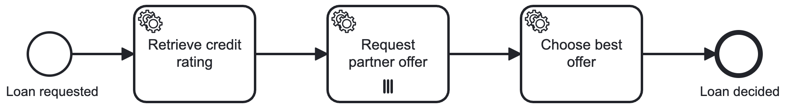

[](./LICENSE)

*Vanilla BP* is **an aspect orientated service provider interface (SPI) for workflow systems as a Java developer would expect it to be**.

This page says what the SPI is and why it exists. How to use it is in the [wiki of this repository](https://github.com/vanillabp/spi-for-java/wiki), one page per topic. The wiki describes 2.0, the current major version. For VanillaBP 1, read the [README of release 1.1.0](https://github.com/vanillabp/spi-for-java/blob/1.1.0/README.md).

Every example in the wiki is taken from one of the [VanillaBP blueprints](https://github.com/vanillabp-blueprints), which compile it and run it in their tests. The [VanillaBP wiki](https://github.com/vanillabp/adapter-platform-integration/wiki) says how you set the SPI up in an application: workflow modules, aggregate persistence, configuration, and the platform you run on (Spring Boot, Quarkus). It also links to the wiki of each BPMS adapter.

## Content

1. [How it looks like](#how-it-looks-like)
2. [Documentation](#documentation)
3. [About the SPI](#about-the-spi)
   1. [Prerequisites](#prerequisites)
   2. [Motivation](#motivation)
   3. [Goals](#goals)
   4. [Available Adapters](#available-adapters)
   5. [Concept](#concept)
4. [Where the promises on this page are held](#where-the-promises-on-this-page-are-held)
5. [Decision log](#decision-log)
6. [Contributing](#contributing)
7. [Noteworthy & Contributors](#noteworthy--contributors)
8. [License](#license)

## How it looks like

Here is a part of a loan approval workflow. It gives you an idea of how your business code uses the Vanilla BP SPI:



```java
@Component
@WorkflowService(
        workflowAggregateClass = LoanApproval.class,
        bpmnProcess = @BpmnProcess(bpmnProcessId = "loan_approval"))
public class LoanApprovalService {

    @Autowired
    private ProcessService<LoanApproval> processService;

    @Autowired
    private CreditRatingClient creditRatings;

    @Autowired
    private PartnerClient partners;

    @Transactional
    public String loanRequested(
            final String loanRequestId,
            final int amount) {

        final var loanApproval = new LoanApproval(loanRequestId, amount);
        ...
        return processService
                .startWorkflow(loanApproval)
                .getLoanRequestId();
    }

    @WorkflowTask
    public void retrieveCreditRating(
            final LoanApproval loanApproval) {

        if (loanApproval.getCreditRating() != null) {
            return; // a BPMS may deliver a task twice
        }

        loanApproval.setCreditRating(
                creditRatings.rate(
                        loanApproval.getLoanRequestId(),
                        loanApproval.getAmount()));
    }

    @WorkflowTask
    public void requestPartnerOffer(
            final LoanApproval loanApproval,
            @MultiInstanceElement("ServiceTask_RequestPartnerOffer")
            final String partnerId) {

        partners.requestOffer(
                partnerId,
                loanApproval.getLoanRequestId(),
                loanApproval.getAmount());
    }
    ...
```

The `@Transactional` is on the method which calls `ProcessService`, and on no other method of the class. Starting a workflow needs a transaction of yours. A task method must not have one. VanillaBP runs a task method in a transaction of its own. It commits that transaction when a [`TaskException`](https://github.com/vanillabp/spi-for-java/wiki/Wiring-a-task#what-a-task-method-may-throw) passes it. If an application transaction joined in, it would turn this into a rollback. So the application does not start if a transaction annotation covers a `@WorkflowTask` method, and the message names the method. [Wiring a task](https://github.com/vanillabp/spi-for-java/wiki/Wiring-a-task#the-transaction-is-vanillabps) explains it.

The first thing `retrieveCreditRating` does is check whether there is a rating already. A remote BPMS may deliver the same task more than once. So write a task method in a way that it can run again, and let the state of the aggregate decide what is left to do.

## Documentation

The [wiki](https://github.com/vanillabp/spi-for-java/wiki/) has one page per topic:

1. [The workflow aggregate](https://github.com/vanillabp/spi-for-java/wiki/The-workflow-aggregate): the entity which holds the data of a workflow, its natural id, what the BPMS gets to see, and how to tell the BPMS that it changed.
2. [Starting and ending workflows](https://github.com/vanillabp/spi-for-java/wiki/Starting-and-ending-workflows): `startWorkflow`, the start by message, the start nobody asked VanillaBP for, and `@WorkflowEnded`.
3. [Wiring a process](https://github.com/vanillabp/spi-for-java/wiki/Wiring-a-process): `@WorkflowService`.
4. [Wiring a task](https://github.com/vanillabp/spi-for-java/wiki/Wiring-a-task): `@WorkflowTask`, `@TaskParam`, the transaction, and `TaskException`.
5. [Wiring an expression](https://github.com/vanillabp/spi-for-java/wiki/Wiring-an-expression): how a condition or a timer reads the workflow aggregate.
6. [Messages and signals](https://github.com/vanillabp/spi-for-java/wiki/Messages-and-signals): `correlateMessage` and `sendSignal`.
7. [Versions of a process](https://github.com/vanillabp/spi-for-java/wiki/Versions-of-a-process): methods which serve only some versions of a process.
8. [Call activities](https://github.com/vanillabp/spi-for-java/wiki/Call-activities): a process split into several BPMN models.
9. [Multi-instance](https://github.com/vanillabp/spi-for-java/wiki/Multi-instance): `@MultiInstanceElement`, `@MultiInstanceIndex`, `@MultiInstanceTotal` and the resolver.
10. [User tasks and asynchronous tasks](https://github.com/vanillabp/spi-for-java/wiki/User-tasks-and-asynchronous-tasks): `@TaskId`, `@TaskEvent`, and completing a task.
11. [The process service](https://github.com/vanillabp/spi-for-java/wiki/The-process-service): every operation of `ProcessService`, and the exceptions they throw.
12. [Showing BPMN and history](https://github.com/vanillabp/spi-for-java/wiki/Showing-BPMN-and-history): what a BPMN viewer needs.

## About the SPI

### Prerequisites

You should know [BPMN](https://en.wikipedia.org/wiki/Business_Process_Model_and_Notation), and you should be able to create useful models with a [modeler tool](https://camunda.com/en/download/modeler/).

*If you do not know BPMN:* BPMN is a graphical notation for business processes. It is stored as XML and also carries meaning, not only pictures. A BPMN engine runs those processes and keeps track of their state. This cuts down the amount of code a lot, because you only implement the "tasks", and the engine handles the flow. Read on to see this in action.

It also helps to know the basics of aspect-oriented development. You do not have to write your own aspects. But you should know that annotations place the provided aspects in your code. When the application starts, your code is scanned for those annotations. Then it is extended behind the scenes to do what the annotation means.

### Motivation

Each BPMN engine has its own APIs. A BPMN engine is also called a Business Process Management System (BPMS) or workflow system. To use a workflow system, a developer has to know its API and understand its ideas. Usually the API is not fully separated from the runtime environment. So the business code has to control things like transactions and the synchronization of concurrent executions, and this also changes how the workflow system behaves.

So the API *bleeds* into the business code, and the business code affects the API. This leads to:

- The API of the BPMS is mixed into the business code.
- All developers have to know the APIs and their rules.
- The business code is harder to read, and so harder to maintain.
- Moving to another technology stack or API (like from Camunda 7 to Camunda 8) means that at least parts of the business logic have to be written again.

### Goals

We created *VanillaBP* to solve the problems from the section [Motivation](#motivation). This SPI holds the best practices we collected since 2014, while we built business processing services with several of those systems. An implementation of the SPI is called an adapter. It hides all the details of the API of the workflow system, so the developer can focus on the business and not on technical details.

The SPI uses several current techniques and concepts to make business process applications simpler: domain-driven design, loose coupling, aspect-oriented programming and "convention over configuration". For us these are not just buzzwords, as the next sections show. They help to keep the BPMN and the business software apart.

### Available Adapters

An implementation of the SPI is called an adapter. It hides all the details of the API of one workflow system, so the developer can focus on the business and not on technical details.

Available adapters:
* [Camunda 7 adapter](https://github.com/vanillabp/camunda7-adapter)
* [Camunda 8 adapter](https://github.com/vanillabp/camunda8-adapter)
* [Process-Engine-API adapter](https://github.com/vanillabp/process-engine-api-adapter)

The wiki page [BPMS adapters](https://github.com/vanillabp/adapter-platform-integration/wiki/BPMS-adapters) lists which adapter serves which BPMS, what to add as a dependency, and what each BPMS can and cannot do. Several adapters may run side by side. [Migrating workflows from one BPMS to another](https://github.com/vanillabp/adapter-platform-integration/wiki/BPMS-migration) is built on that. It is a matter of configuration. It changes nothing in your code, except the few places the wiki notes, where an API call reaches more than one BPMS.

### Concept

Imagine you have to write the business processing software for a loan approval.

*How will the code be structured?*

The basic idea is a small group of service beans. Together they implement all requirements of one business process.

If the process needs external services or components, those service beans are the front for all of them. So no third-party dependency is bound close to the BPMN. Then the compiler shows you changes in those external dependencies, and you do not find them only at runtime.

*How many services do you need to implement?*

In the best case one service bean is enough. One workflow, implemented by one service bean!

In more complex processes you can usually find parts of the work (retrieve a rating, collect partner offers, handle the payout, etc.). Each part can be a bucket of meaning, mapped to a service bean of its own.

*How are those service beans wired to the BPMN?*

In BPMN there are tasks (e.g. service-task, send-task, etc.). They are wired to methods of that service by name. And there are expressions (e.g. conditional-flows). They are evaluated against a [workflow-aggregate](https://martinfowler.com/bliki/DDD_Aggregate.html) of the process (see *How is data handled?*).

All names which wire tasks or expressions should be natural language in camel case. Either the BPMN designer defines them (BPMN-first approach), or the developer defines them first (software-first approach). This makes the BPMN designer name the expected data and behavior. It also helps developers to understand what they have to implement.

All those names together are the contract between the BPMN and the implementation behind it. For example, these are typical names in a loan approval workflow:

- LoanRequested (message name)
- retrieveCreditRating (service task)
- requestPartnerApproval (send task)
- ratedAcceptable (aggregate attribute read by a gateway)
- customerInformed (aggregate attribute)

*How is data handled?*

A domain aggregate is a persistent entity. It stores the data which the process needs to run (e.g. in expressions), and the data which the implementation needs to do the tasks. The aggregate does not keep all the data the workflow ever needs. But it stores at least references, so the needed values can be fetched when they are needed.

If some attributes are needed often (e.g. by nearly every task), the aggregate can be a *cache* of the original source of the data. Depending on the use case, you may have to implement a proper update strategy.

## Where the promises on this page are held

This module ships annotations and interfaces, and no runtime of its own. So no test here can fail when a sentence on this page or in the wiki stops being true. The platform integration holds these promises, and its module READMEs name the test for each section: [`migration-adapter/README.md`](https://github.com/vanillabp/adapter-platform-integration/blob/main/migration-adapter/README.md) for everything the core decides, and the README of each adapter for what its BPMS decides. Where a promise belongs to the BPMS and not to VanillaBP, the sentence says so where it makes the promise. That is the same rule from the other side.

## Decision log

[`DECISIONS.md`](./DECISIONS.md) holds the decisions several places in this repository rely on. It
is the only thing the code may cite. A citation reads `see decision 2 in the repository's
DECISIONS.md`. Numbers are never reused. An entry which is overturned stays and names the entry
which replaced it. So a citation written today still points at the right entry in a year. The
entries are the promises this API makes to an application: where the state of a workflow lives,
what addresses it, what the BPMS gets to see, and what an exception thrown by a handler means.

## Contributing

Issues and pull requests are welcome. [`CONTRIBUTING.md`](./CONTRIBUTING.md) says how this
repository is built and what is asked before a change is written. A change here reaches every
application and every BPMS adapter at once. So by default a change only adds, and removes
nothing.

## Noteworthy & Contributors

VanillaBP was developed by [Phactum](https://www.phactum.at) with the intention of giving back to the community as it has benefited the community in the past.


Special thanks go to Martin Schimak, [plexiti GmbH](https://plexiti.com/about/), who inspired us to apply DDD to workflow.

## License

Copyright 2026 Phactum Softwareentwicklung GmbH

Licensed under the Apache License, Version 2.0
